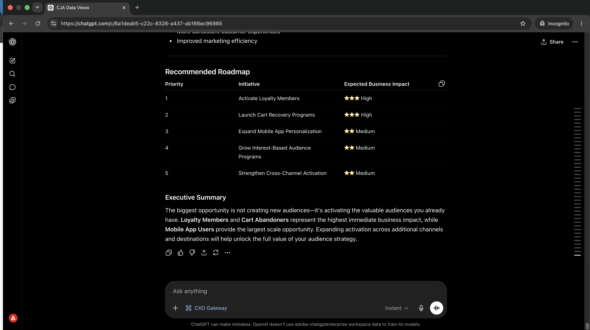
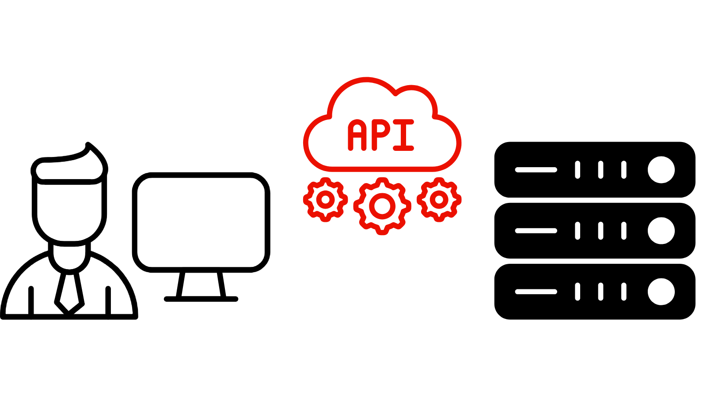

# エージェント型ツール

<!-- last-modified: 2026-06-08 -->

あらゆるエージェンティックツールが同じニーズに対応するわけではありません。 それぞれが何をするのか、いつ使用するのか、どのように始めるべきかを検討し、状況に適した出発点を選択できるようにします。

<!--
CARDS

* mcp-servers.md
  {title = MCP Servers}
  {description = Connect any compatible AI platform to Adobe CX Enterprise data and workflows. No coding required.}
  {cta = Explore MCP Servers}
  {image = ../assets/mcp-servers-card.png}

* agent-skills.md
  {title = Agent Skills}
  {description = Adobe-curated workflow instructions that guide agents through CX Enterprise tasks consistently.}
  {cta = Explore Agent Skills}
  {image = ../assets/agent-skills-card.png}

* apis.md
  {title = APIs for Builders}
  {description = Build custom applications and integrations using the same APIs that power Adobe products.}
  {cta = Explore APIs for Builders}
  {image = ../assets/apis-card.png}

-->
<!-- START CARDS HTML - DO NOT MODIFY BY HAND -->

    

        

            

                <figure class="image x-is-16by9">
                    
                </figure>
            

            

                

                    

                        <a href="mcp-servers.md" title="MCP サーバー">MCP サーバー</a>
                    

                    
互換性のあるあらゆるAI基盤を、Adobe CX Enterpriseのデータおよびワークフローに接続。 コーディングは必要ありません。

                

                <a href="mcp-servers.md" class="spectrum-Button spectrum-Button--outline spectrum-Button--primary spectrum-Button--sizeM" style="align-self: flex-start; margin-top: 1rem;">
                    MCP サーバーの探索
                </a>
            

        

    

    

        

            

                <figure class="image x-is-16by9">
                    
                </figure>
            

            

                

                    

                        <a href="agent-skills.md" title="エージェントスキル"> エージェントのスキル </a>
                    

                    
Adobeがキュレートしたワークフロー手順により、エージェントは一貫してCX Enterpriseのタスクを進めることができます。

                

                <a href="agent-skills.md" class="spectrum-Button spectrum-Button--outline spectrum-Button--primary spectrum-Button--sizeM" style="align-self: flex-start; margin-top: 1rem;">
                     エージェントのスキルを探る
                </a>
            

        

    

    

        

            

                <figure class="image x-is-16by9">
                    
                </figure>
            

            

                

                    

                        ビルダー</a>の<a href="apis.md" title="ビルダー用API">API
                    

                    
Adobeと同じAPIを使用して、カスタムアプリケーションや統合機能を構築できます。

                

                <a href="apis.md" class="spectrum-Button spectrum-Button--outline spectrum-Button--primary spectrum-Button--sizeM" style="align-self: flex-start; margin-top: 1rem;">
                     ビルダー用APIの探索
                </a>
            

        

    

<!-- END CARDS HTML - DO NOT MODIFY BY HAND -->

## エージェント型ツールの比較

| | MCP サーバー | エージェントスキル | ビルダー用API |
| --- | --- | --- | --- |
| 最適な用途 | CX Enterprise アプリケーションユーザー | CX Enterprise アプリケーションユーザーと開発者 | デベロッパー |
| コーディングが必要 | × | × | ○ |
| 設定時間 | Minutes | Minutes | 時間から日 |
| 得られるもの | AI基盤からCX Enterpriseアプリケーションにアクセスし | ガイド付きの反復可能なワークフロー | 完全なプログラム制御 |

## どこから始めてよいかわからない方は、

- AIを使用してCX Enterprise アプリケーションと対話する（アクションを実行し、データを照会し、AIが自然な会話を通じて次に何をすべきかを発見できるようにする）には、[MCP サーバー](mcp-servers.md)が最も柔軟な出発点となります。
- エージェントがCX Enterprise ワークフローに関するAdobeのベストプラクティスに即興で従えるように、[ エージェントスキル ](agent-skills.md)はそのドメインの専門知識を再利用可能な手順にエンコードします。
- CX Enterpriseの特定のワークフローを合理化または自動化する専用アプリケーションを構築するには、[ ビルダー用API](apis.md)を使用すると、何が起こるかを正確に制御できます。

>[!BEGINTABS]

>[!TAB MCP サーバー]

MCP サーバーは、AI プラットフォームとCX Enterpriseアプリケーションを接続するライブワイヤーだと考えてください。 [Adobe CX Enterprise Coworker for AI Platforms](mcp-servers.md#connect-to-your-ai-platform)から始めます。一度つながると、AI基盤でAdobe CX Enterprise Coworkerを使用して、キャンペーンのクエリ、オーディエンスの取得、ジャーニーのステータスの確認などを簡単な言葉で実行できます。コードは必要ありません。 機能しない場合は、[製品MCP サーバー](mcp-servers.md#connect-to-your-ai-platform)に直接接続してください。

**次の場合にMCP サーバーを使用：**

- AIをCX Enterpriseのワークフローに直接統合し
- 既存のAI基盤にCX Enterpriseのデータを組み込むことで
- 探索分析や高度なデータ取得を行っている場合
- プロジェクトを立ち上げることなく、すばやく成果を達成

[MCP サーバーの探索](mcp-servers.md)

>[!TAB  エージェントのスキル ]

担当者のスキルは、Adobeのドメインの専門知識であり、担当者が従うことのできる指示としてエンコードされます。 担当者が適切なステップを見つけられることを期待するのではなく、CX Enterpriseのワークフローに合わせて何をすべきか、確実に、繰り返し、事前に調整すべきことを正確に指示できます。

**次の場合にエージェントのスキルを使用：**

- AIを利用してCX Enterprise アプリケーションで作業する場合は、Adobeのベストプラクティスに従ってください
- 同じタスクを毎回同じように実行する必要があります
- 反復可能なコンテンツやメディア制作ワークフローを運用している

[エージェントのスキルを見る](agent-skills.md)

>ビルダー]の[!TAB API

APIは構成要素です。 開発者は、Adobeの自社製品と同じAPIを使用して、Adobeのデータとオペレーションに直接プログラムでアクセスできます。 これらのツールを利用して、特定のビジネスワークフローを合理化し、組織が必要とするガードレールを備えたカスタマイズされたエクスペリエンスを構築できます。

**次の場合にAPIを使用：**

- 特定のビジネスユースケース向けに、カスタムアプリケーションや統合を構築する場合
- 特定のガードレールとコントロールにより、ワークフローを最適化または自動化する必要があります
- クロードコードまたはカーソルを使用して、完全なアプリケーションを生成します
- CX Enterpriseのデータを

[ビルダー用APIの確認](apis.md)

>[!ENDTABS]

## それらを一緒に使用

これらのツールは連携するように設計されています。 それらを組み合わせることで、Adobe AIを最大限に活用できます。 エージェントスキルは、AI プラットフォームがMCP サーバーをどのように使用するかを導き、エージェントをCX Enterpriseワークフローに適切な軌道に乗せます。 また、スキルは、APIを呼び出す方法とタイミングを判断し、Adobeのベストプラクティスのガードレールをカスタムビルドの自動化に追加することもできます。 ひとつのチャネルだけを選択する必要はありません。

## エージェント型ツールの活用例

CX Enterpriseのワークフローに適したツールをご覧ください。

<!--
CARDS

* ../use-cases/query-audiences.md
  {title = Audience activation at a glance}
  {description = See which audiences are live, where they are flowing, and whether destinations are healthy, without navigating Real-Time CDP.}
  {cta = Check audience activation}

* https://experienceleague.adobe.com/en/docs/experience-manager-learn/cloud-service/ai/ai-assisted-development/use-cases/component-development
  {title = Develop AEM components with AI}
  {description = Use Claude Code or Cursor with Agent Skills to scaffold, code, and refine AEM components guided by Adobe best practices.}
  {cta = Try with Agent Skills}
  {image = ../assets/agent-skills-card.png}

* https://experienceleague.adobe.com/en/docs/experience-manager-learn/cloud-service/aem-apis/openapis/invoke-api-using-oauth-web-app
  {title = Invoke AEM APIs from a web app}
  {description = Build a web application that authenticates users and calls AEM OpenAPIs using OAuth to deliver governed, programmatic access.}
  {cta = Try with APIs}
  {image = ../assets/using-api-card.png}

-->
<!-- START CARDS HTML - DO NOT MODIFY BY HAND -->

    

        

            

                <figure class="image x-is-16by9">
                    
                </figure>
            

            

                

                    

                        <a href="../use-cases/query-audiences.md" title="オーディエンスのアクティベーション概要"> オーディエンスのアクティベーション概要</a>
                    

                    
Real-Time CDPを使わずに、どのオーディエンスがライブなのか、どこを流れているのか、宛先が健全なのかを確認できます。

                

                <a href="../use-cases/query-audiences.md" class="spectrum-Button spectrum-Button--outline spectrum-Button--primary spectrum-Button--sizeM" style="align-self: flex-start; margin-top: 1rem;">
                     オーディエンスのアクティブ化を確認
                </a>
            

        

    

    

        

            

                <figure class="image x-is-16by9">
                    
                </figure>
            

            

                

                    

                        <a href="https://experienceleague.adobe.com/en/docs/experience-manager-learn/cloud-service/ai/ai-assisted-development/use-cases/component-development" target="_blank" rel="referrer" title="AIを活用したAEMコンポーネントの開発">AIを使用してAEM コンポーネントを開発</a>
                    

                    
Agent SkillsでClaude CodeまたはCursorを使用して、Adobeのベストプラクティスに従って、AEM コンポーネントを基礎モード化、コード化、調整します。

                

                <a href="https://experienceleague.adobe.com/en/docs/experience-manager-learn/cloud-service/ai/ai-assisted-development/use-cases/component-development" target="_blank" rel="referrer" class="spectrum-Button spectrum-Button--outline spectrum-Button--primary spectrum-Button--sizeM" style="align-self: flex-start; margin-top: 1rem;">
                     エージェントのスキルを試す
                </a>
            

        

    

    

        

            

                <figure class="image x-is-16by9">
                    
                </figure>
            

            

                

                    

                        <a href="https://experienceleague.adobe.com/en/docs/experience-manager-learn/cloud-service/aem-apis/openapis/invoke-api-using-oauth-web-app" target="_blank" rel="referrer" title="Web アプリからのAEM APIの呼び出し">Web アプリからAEM APIを呼び出す</a>
                    

                    
OAuthを使用してユーザーを認証し、AEM OpenAPIを呼び出して、管理されたプログラマティックなアクセスを提供するweb アプリケーションを構築します。

                

                <a href="https://experienceleague.adobe.com/en/docs/experience-manager-learn/cloud-service/aem-apis/openapis/invoke-api-using-oauth-web-app" target="_blank" rel="referrer" class="spectrum-Button spectrum-Button--outline spectrum-Button--primary spectrum-Button--sizeM" style="align-self: flex-start; margin-top: 1rem;">
                    APIで試す
                </a>
            

        

    

<!-- END CARDS HTML - DO NOT MODIFY BY HAND -->
